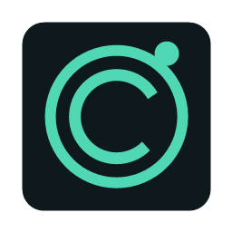

<div align="center">
  
  <h1>PC Booster</h1>
  <p>A calm, local-first Windows toolkit for system monitoring and reversible cleanup.</p>
  <p>
    <a href="https://github.com/Mayer-ELbot/PC-Booster/releases/latest"></a>
    <a href="LICENSE"></a>
  </p>
</div>

PC Booster keeps an eye on CPU, memory, storage, and GPU activity, and gives you a small set of deliberate Windows maintenance tools. It runs locally, asks before making changes, and avoids force-closing apps or disabling core Windows services.

## Download

Download the latest standalone **[PC Booster for Windows](https://github.com/Mayer-ELbot/PC-Booster/releases/latest/download/PC.Booster.exe)** from GitHub Releases. No Python installation is required.

Windows may show a SmartScreen prompt because the executable is not code-signed. The source and build workflow are public so you can inspect how it is made.

## What it does

- **Live overview:** CPU, memory, system-drive usage and activity, and GPU activity. NVIDIA systems can also show GPU memory and temperature when the local `nvidia-smi` utility is available.
- **Memory Manager:** review visible desktop apps running under your account, sorted by memory use. Ask selected apps to close normally so each app can show its own save prompt. PC Booster never force-terminates an app or purges memory behind your back.
- **Memory pressure guidance:** after three low-memory readings, get a reminder to review high-usage apps. No apps are closed automatically.
- **Storage Cleanup:** review files in your account's temporary folder by age, then move selected files to the Recycle Bin.
- **Startup Apps:** disable or restore entries in your current-user startup list.
- **Reversible Windows Tweaks:** reduce minimize/maximize animation and turn off transparency for your Windows account. Original values are saved locally so you can restore them.
- **Background mode:** keep monitoring from the system tray, reduce sampling frequency while hidden, and optionally start minimized when you sign in to Windows.

## Background and startup

Open **Windows Tweaks** and choose **Start PC Booster when I sign in to Windows** to add or remove its entry in your account's `Run` registry key. This is off until you enable it. With startup enabled, the app starts minimized to the tray. Close or minimize the window to keep it in the tray; choose **Exit PC Booster** from the tray menu to quit completely.

## Safety and privacy

- Changes apply to the current Windows account and are reversible where the app offers a restore action.
- Cleanup is restricted to the current user's temporary folder; selected files go to the Recycle Bin.
- The app does not disable Windows Update, Defender, system services, or the page file.
- Monitoring and settings stay on this PC. PC Booster does not send telemetry or make network requests.
- App memory figures are working-set estimates; closing an app may not release that entire amount. Save your work before asking an app to close.
- Settings and restore backups are stored under `%LOCALAPPDATA%\PC Booster`.

## Build from source

Requirements: Windows, Python 3.14, and the packages in `requirements.txt`.

```powershell
py -3.14 -m pip install -r requirements.txt
py -3.14 app.py
```

Build a standalone, windowed executable:

```powershell
.\build.ps1
```

The executable is written to `dist/PC Booster.exe`. Downloadable builds are published in [GitHub Releases](https://github.com/Mayer-ELbot/PC-Booster/releases).

## Contributing

Issues and pull requests are welcome. Keep changes focused, explain Windows settings that are changed, and preserve clear restore paths for system tweaks.

## License

PC Booster is released under the [MIT License](LICENSE).

---

Made for Windows users who want useful controls without mystery optimizations.
